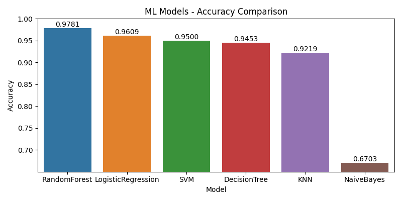
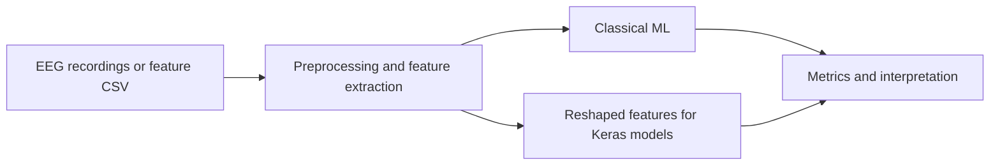
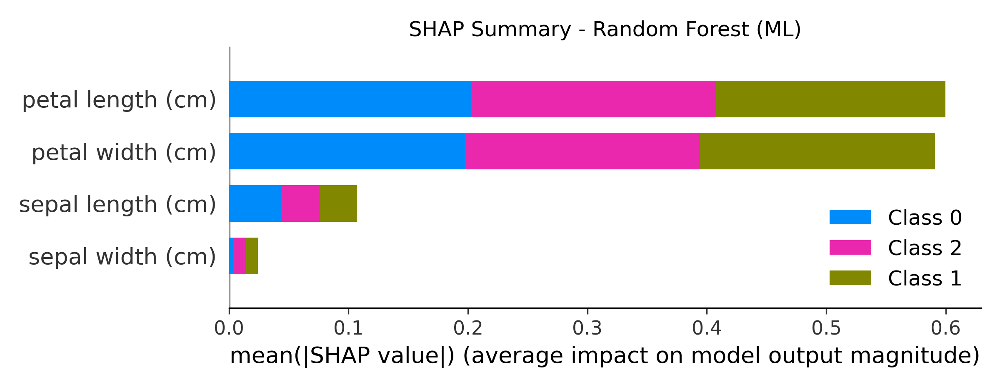

# NeuroSentiScan

An offline Python research project that benchmarks classical machine learning and deep learning for three-class EEG classification. It includes feature extraction, training, aggregate evaluation, and interpretation scripts.



## Pipeline



- **Data.** The local feature table contains 2,132 rows and 2,548 input columns. Its stored labels are `NEGATIVE`, `NEUTRAL`, and `POSITIVE`. The accompanying project report discusses the experiments in a stress-classification context.
- **Modeling.** scikit-learn scripts benchmark SVM, Random Forest, KNN, Logistic Regression, Naive Bayes, and Decision Tree. TensorFlow/Keras scripts explore CNN, recurrent, hybrid, and EEGNet-style architectures.
- **Evaluation.** The repository includes classification reports, model comparison plots, and a SHAP example. Scripts also explore local LIME explanations, PCA and t-SNE, and majority voting.

## Saved results

| Model | Accuracy | Macro F1 | Evaluation rows |
| --- | ---: | ---: | ---: |
| [Random Forest](outputs/RandomForest_report.csv) | 97.97% | 0.9797 | 640 |
| [1D CNN](outputs/CNN_1D_report.csv) | 99.06% | 0.9906 | 640 |

These numbers come from saved experiment reports. The current training scripts split individual rows, and the deep-learning scripts fit their scaler before splitting. A stronger comparison would split by subject and fit preprocessing on training data only. The scores describe this experiment and do not establish performance on unseen people or clinical usefulness.



## Run locally

Use Python 3.11 and run commands from the repository root. The dependency file pins the original experiment environment.

```bash
python -m venv .venv
```

Activate the environment before installing. In Windows PowerShell, run `& .\.venv\Scripts\Activate.ps1`. In Bash, run `source .venv/bin/activate`.

```bash
python -m pip install -r requirements.txt
```

To regenerate the comparison plots from the included aggregate CSV reports:

```bash
python scripts/plot_results.py
```

To retrain, supply a dataset you are authorized to use at `data/datasets/eeg_data.csv`. The training scripts expect 2,548 numeric feature columns and a `label` column using the labels above.

```bash
python scripts/load_csv_data.py
python scripts/train_ml.py
python scripts/train_dl.py
```

This repository contains scripts, notebooks with cleared outputs, and aggregate evaluation artifacts. Raw EEG recordings, the feature dataset, per-sample predictions, trained weights, and the local research PDF are kept outside the repository.

## Repository guide

- [scripts/](scripts/) contains data preparation, training, evaluation, and interpretation.
- [notebooks/](notebooks/) contains feature engineering and exploratory experiments.
- [outputs/](outputs/) and [graph/](graph/) contain selected aggregate reports and figures.

Project materials are for academic and non-commercial use, as documented in the original project.
