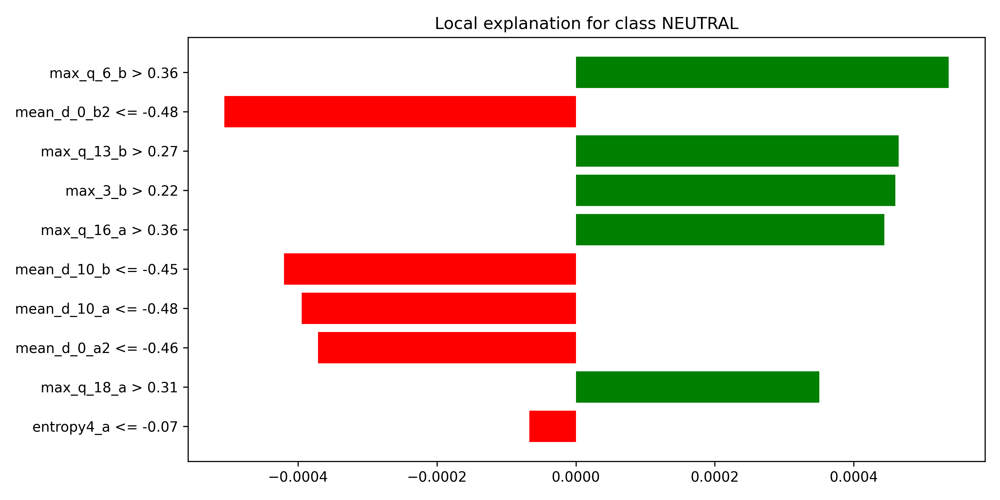
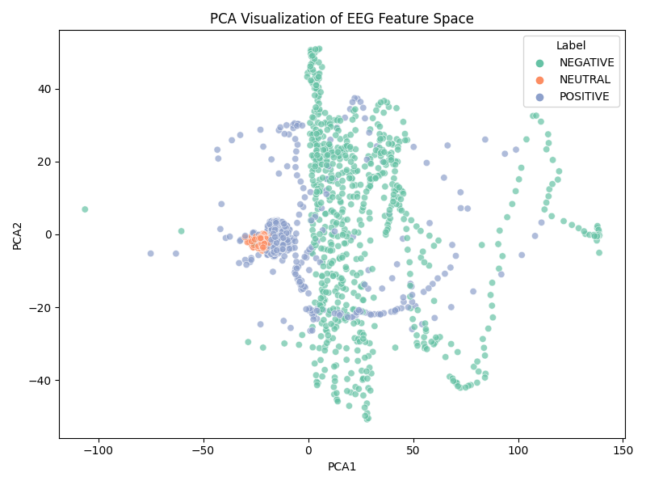

# NeuroSentiScan

A reproducible benchmark for three-class EEG emotion classification. The project compares scikit-learn, XGBoost, and TensorFlow/Keras models on the same held-out sample rows and uses SHAP to explain a fitted EEG Random Forest.

## Models and experiment design

| Family | Models |
| --- | --- |
| Baseline | Most-frequent class |
| Classical machine learning | Logistic Regression, SVM, KNN, Gaussian Naive Bayes, Decision Tree, Random Forest, XGBoost |
| Feature-selection ablation | Random Forest with the top 100 features selected using the training labels |
| Deep learning | 1D CNN, LSTM, CNN-LSTM, BiLSTM, and an EEGNet-inspired convolutional model |
| Ensemble | Majority vote across the evaluated classifiers, excluding the baseline |

### Reproducible evaluation

1. **Identify the input and split it once.** The benchmark records the input CSV's SHA-256 checksum, software versions, and random seed (42). The checked-in run uses a stratified 60/20/20 split by row. The splitter keeps exact duplicate feature rows together if they occur. The split manifest records each original row index and its partition, so a rerun can be checked against the published assignment.
2. **Fit on training rows.** Models, scalers, and supervised feature selectors learn from the training rows. The same fitted transformations are applied to validation and test data. This prevents those rows from influencing scaling or feature selection.
3. **Use validation for early stopping.** Neural models use validation loss to decide when to stop and restore their best weights. The test rows are reserved for scoring the fitted models.
4. **Compare predictions for the same samples.** Every model predicts the same test rows. The run writes one prediction table keyed by row index. The ensemble votes across those aligned predictions with a fixed class-order tie break. Paired comparisons use the same rows, with McNemar's test and Holm adjustment.

Accuracy is the fraction of correct predictions. Macro F1 averages the F1 scores of the three classes with equal weight. Reproducibility here covers the data, split, training procedure, and metrics. Exact neural scores can vary by software or hardware environment.

The neural models reshape the 2,548 engineered features into a 49 × 52 grid. The grid is a model input convention. Its axes do not represent verified EEG channels or time steps.

## Benchmark results

The checked-in run used 1,278 training rows, 427 validation rows, and 427 test rows. All scores below are from the same stratified **row-level** test partition.

| Model | Accuracy | Macro F1 |
| --- | ---: | ---: |
| XGBoost | 99.30% | 0.9930 |
| Random Forest | 98.36% | 0.9836 |
| Majority vote | 97.42% | 0.9741 |
| Logistic Regression | 96.02% | 0.9600 |
| BiLSTM | 96.02% | 0.9600 |
| EEGNet-inspired CNN | 96.02% | 0.9600 |
| Random Forest (top 100) | 96.02% | 0.9599 |
| Decision Tree | 95.78% | 0.9577 |
| CNN-LSTM | 95.55% | 0.9554 |
| LSTM | 95.08% | 0.9504 |
| SVM | 94.38% | 0.9433 |
| 1D CNN | 93.68% | 0.9366 |
| KNN | 93.44% | 0.9336 |
| Gaussian Naive Bayes | 43.09% | 0.3255 |
| Most-frequent baseline | 33.49% | 0.1673 |


[Run configuration](benchmark-results/run.json) · [Split manifest](benchmark-results/split.csv) · [Per-class reports](benchmark-results/reports.json) · [Paired comparisons](benchmark-results/paired_comparisons.csv)

## Explainable AI

| Method | What it explains | Project output |
| --- | --- | --- |
| **SHAP** | Which EEG features contributed most to the fitted Random Forest's class predictions across a sample of test rows | Current benchmark. [SHAP feature rankings](benchmark-results/shap_importance.csv) |
| **LIME** | Which features locally supported or opposed a single prediction, using an approximation around that example | Earlier EEG experiments with saved SVM, Random Forest, KNN, Naive Bayes, Logistic Regression, and Decision Tree models. [LIME script](scripts/explainability.py) |
| **Model-native importance** | How fitted models ranked features using tree importance or absolute linear coefficients | Earlier EEG dashboard. The two measures have different meanings and are best read within each model. [Dashboard script](scripts/feature_importance_dashboard.py) |

### SHAP for the current EEG benchmark


The benchmark fits the full-feature Random Forest on the training partition, then runs TreeSHAP on a fixed sample of 64 test rows. The figure averages the **absolute** attribution across rows and classes. A longer bar means a larger typical contribution to the model's output. To answer whether a feature pushed a particular prediction toward a class, inspect the signed values for that row and class. These attributions describe the fitted model.

### LIME and the earlier explanation outputs

The earlier LIME script loads saved EEG models and their scalers, explains individual predictions, and exports HTML and PNG examples. Those explanations used the earlier workflow and were not regenerated on the current held-out split. The original Iris SHAP demo also remains available as an exploratory script. [Iris SHAP demo](scripts/explainability_SHAP.py)



*Original report, Figure 6. This SVM example explains one prediction for the neutral class. Positive and negative bars show how features support or oppose that class in the local approximation.*

### Exploratory EEG feature visualization

<details>
<summary>PCA view from the original report</summary>



*Original report, Figure 7 (PCA panel). The scatterplot describes the feature distribution. The benchmark table above reports held-out model performance.*

</details>

## Dataset and attribution

The local CSV used for the benchmark matches the Kaggle download of Jordan J. Bird’s [EEG Brainwave Dataset: Feeling Emotions](https://www.kaggle.com/datasets/birdy654/eeg-brainwave-dataset-feeling-emotions/data) byte for byte. It contains 2,132 rows and 2,548 features, with 708 negative, 716 neutral, and 708 positive labels. Feature extraction is credited to the original authors.

- **Research citation.** Jordan J. Bird, Anikó Ekárt, Christopher D. Buckingham, and Diego R. Faria, *Mental Emotional Sentiment Classification with an EEG-based Brain-machine Interface*, DISP 2019. [Paper](https://jordanjamesbird.com/publications/Mental-Emotional-Sentiment-Classification-with-an-EEG-based-Brain-machine-Interface.pdf)
- **Data rights.** Kaggle lists the data files as © Original Authors. Download the dataset from the source and follow its terms. This repository publishes aggregate results and the code to reproduce them.
- **Evaluation limits.** The distributed CSV contains no verified participant or session IDs. Row-level partitions can contain recordings from shared participants or sessions. These scores provide no estimate of performance on new people. Paired tests are descriptive for this split because dependence between rows cannot be ruled out. With a dataset that has reliable participant IDs and enough groups, pass `--group-column participant_id` to keep participants in separate partitions.

## Reproduce the benchmark

Use Python 3.12 in a virtual environment and run from the repository root. On Windows, create the environment under a short path if TensorFlow installation hits a filename-length error. Download `emotions.csv` from the Kaggle dataset page. In the original local project, use `data/datasets/eeg_data.csv` as the input path instead.

```bash
python -m pip install -r requirements-benchmark.txt
python scripts/benchmark.py path/to/emotions.csv --output runs/eeg --shap --save-models
python -m unittest discover -s tests
```

The output includes the split manifest, data checksum, dependency versions, per-row predictions, per-class reports, paired comparisons, and figures. With `--save-models`, the CLI saves the fitted estimators and the neural scaler under the run directory. The class order is `NEGATIVE`, `NEUTRAL`, `POSITIVE`. For a smaller run, pass `--models dummy random_forest cnn --epochs 2`.

GitHub Actions runs the tests and exercises a smaller pipeline on synthetic data. The previous notebooks, MATLAB experiments, and historical reports document earlier exploration. Those workflows use different data and splits. The historical scores are superseded by the shared-split benchmark above.

Project materials are for academic and non-commercial use, as documented in the original project.
