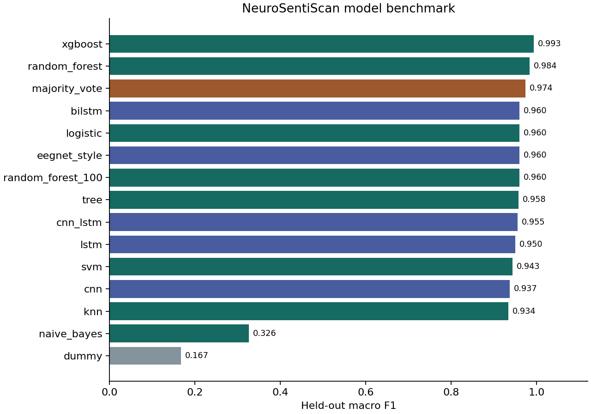
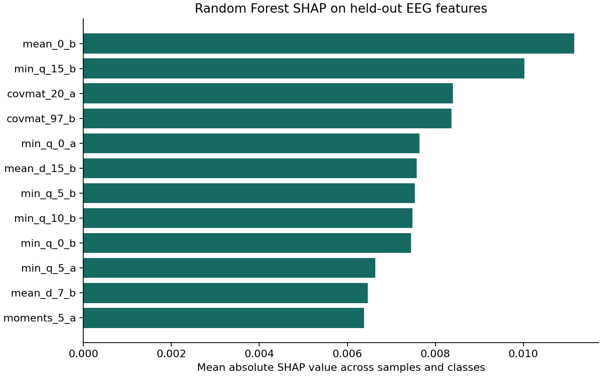

# NeuroSentiScan

A reproducible benchmark for three-class EEG emotion classification. The project compares scikit-learn, XGBoost, and TensorFlow/Keras models on the same held-out sample rows and uses SHAP to explain a fitted EEG Random Forest.

## Models and experiment design

| Family | Models |
| --- | --- |
| Baseline | Most-frequent class |
| Classical machine learning | Logistic Regression, SVM, KNN, Gaussian Naive Bayes, Decision Tree, Random Forest, XGBoost |
| Feature-selection ablation | Random Forest with the top 100 features selected using the training labels |
| Deep learning | 1D CNN, LSTM, CNN-LSTM, BiLSTM, and an EEGNet-inspired convolutional model |
| Ensemble | Majority vote across the evaluated classifiers, excluding the baseline |

The CSV is split once with seed 42. Exact duplicate feature rows stay in one partition. Scaling and any supervised feature selection are fitted on training rows. Neural early stopping uses validation rows. The test partition is shared by every model, and a single prediction table preserves row identity. The ensemble uses a fixed class-order tie break. The benchmark reports accuracy, macro F1, per-class metrics, and exploratory paired McNemar comparisons with Holm adjustment.

The neural models reshape the 2,548 engineered features into a 49 × 52 grid. The grid is a model input convention. Its axes do not represent verified EEG channels or time steps.

## Benchmark results

The checked-in run used 1,278 training rows, 427 validation rows, and 427 test rows. All scores below are from the same stratified **row-level** test partition.

| Model | Accuracy | Macro F1 |
| --- | ---: | ---: |
| XGBoost | 99.30% | 0.9930 |
| Random Forest | 98.36% | 0.9836 |
| Majority vote | 97.42% | 0.9741 |
| Logistic Regression | 96.02% | 0.9600 |
| BiLSTM | 96.02% | 0.9600 |
| EEGNet-inspired CNN | 96.02% | 0.9600 |
| Random Forest (top 100) | 96.02% | 0.9599 |
| Decision Tree | 95.78% | 0.9577 |
| CNN-LSTM | 95.55% | 0.9554 |
| LSTM | 95.08% | 0.9504 |
| SVM | 94.38% | 0.9433 |
| 1D CNN | 93.68% | 0.9366 |
| KNN | 93.44% | 0.9336 |
| Gaussian Naive Bayes | 43.09% | 0.3255 |
| Most-frequent baseline | 33.49% | 0.1673 |





The SHAP figure summarizes a deterministic sample of 64 test rows from the fitted full-feature Random Forest. The bars show model sensitivity to input features in this experiment.

[Run configuration](benchmark-results/run.json) · [Split manifest](benchmark-results/split.csv) · [Per-class reports](benchmark-results/reports.json) · [Paired comparisons](benchmark-results/paired_comparisons.csv)

## Dataset and attribution

The local CSV used for the benchmark matches the Kaggle download of Jordan J. Bird’s [EEG Brainwave Dataset: Feeling Emotions](https://www.kaggle.com/datasets/birdy654/eeg-brainwave-dataset-feeling-emotions/data) byte for byte. It contains 2,132 rows and 2,548 features, with 708 negative, 716 neutral, and 708 positive labels. Feature extraction is credited to the original authors.

- **Research citation.** Jordan J. Bird, Anikó Ekárt, Christopher D. Buckingham, and Diego R. Faria, *Mental Emotional Sentiment Classification with an EEG-based Brain-machine Interface*, DISP 2019. [Paper](https://jordanjamesbird.com/publications/Mental-Emotional-Sentiment-Classification-with-an-EEG-based-Brain-machine-Interface.pdf)
- **Data rights.** Kaggle lists the data files as © Original Authors. Download the dataset from the source and follow its terms. This repository publishes aggregate results and the code to reproduce them.
- **Evaluation limits.** The distributed CSV contains no verified participant or session IDs. Row-level partitions can contain recordings from shared participants or sessions. These scores provide no estimate of performance on new people. Paired tests are descriptive for this split because dependence between rows cannot be ruled out. With a dataset that has reliable participant IDs and enough groups, pass `--group-column participant_id` to keep participants in separate partitions.

## Reproduce the benchmark

Use Python 3.12 in a virtual environment and run from the repository root. On Windows, create the environment under a short path if TensorFlow installation hits a filename-length error. Download `emotions.csv` from the Kaggle dataset page.

```bash
python -m pip install -r requirements-benchmark.txt
python scripts/benchmark.py path/to/emotions.csv --output runs/eeg --shap --save-models
python -m unittest discover -s tests
```

The output includes the split manifest, data checksum, dependency versions, per-row predictions, per-class reports, paired comparisons, and figures. With `--save-models`, the CLI saves the fitted estimators and the neural scaler under the run directory. The class order is `NEGATIVE`, `NEUTRAL`, `POSITIVE`. For a smaller run, pass `--models dummy random_forest cnn --epochs 2`.

GitHub Actions runs the tests and exercises a smaller pipeline on synthetic data. The previous notebooks, MATLAB experiments, and historical reports document earlier exploration. Those workflows use different data and splits. The older SHAP demonstration uses Iris, and the historical scores are superseded for this portfolio benchmark.

Project materials are for academic and non-commercial use, as documented in the original project.
